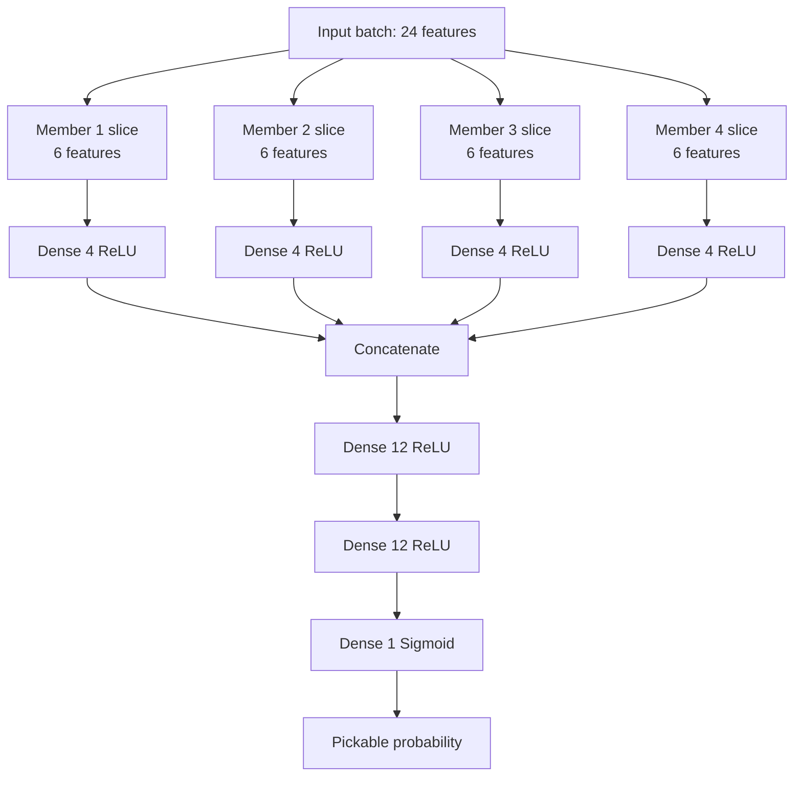

# Pickaboo Model

This project prepares raw ArUco batch data and trains a binary classifier that predicts whether a batch is pickable.

## Files

- `data_cleaner.py` converts raw session JSON files into `clean_data/all_data.json`
- `data_preparer.py` converts `clean_data/all_data.json` into `clean_data/prepared_data.json`
- `trainer.py` trains the model from `clean_data/prepared_data.json`
- `pickaboo.h5` is the saved trained model
- `scaler.npy` is the fitted feature scaler used during training

## Data Flow

1. Start from the raw JSON files in `raw_data/`
2. Run `data_cleaner.py` to build `clean_data/all_data.json`
3. Run `data_preparer.py` to build `clean_data/prepared_data.json`
4. Run `trainer.py` to train the model and save the artifacts

## Prepared Data Input

The trainer expects `clean_data/prepared_data.json` to be a list of batches. Each batch must have this structure:

```json
{
  "batch_id": 1,
  "members": [
    {
      "x": 0.035,
      "y": -0.017,
      "z": 0.059,
      "deviation": 32.851,
      "blue": false
    }
  ],
  "pickable": true,
  "cam_distance": 2.062
}
```

### Feature layout

Each batch is converted into a 24-value feature vector:

- Member 1: `x`, `y`, `z`, `deviation`, `blue`, `cam_distance`
- Member 2: `x`, `y`, `z`, `deviation`, `blue`, `cam_distance`
- Member 3: `x`, `y`, `z`, `deviation`, `blue`, `cam_distance`
- Member 4: `x`, `y`, `z`, `deviation`, `blue`, `cam_distance`

Boolean `blue` is encoded as `1.0` for true and `0.0` for false.

## Output

The model predicts a single probability in the range `[0, 1]`:

- close to `0` means non-pickable
- close to `1` means pickable

A common classification rule is:

- `prediction >= 0.5` => pickable
- `prediction < 0.5` => non-pickable

## Training Details

The trainer does the following standard steps:

- randomizes the batches
- splits the data into `0.8 / 0.1 / 0.1` train, validation, and test sets
- standardizes the features with `StandardScaler`
- trains a neural network with binary cross-entropy loss
- evaluates on the test set
- saves the trained model and scaler

## Model Architecture

The model uses four parallel member branches. Each branch receives the six values for one member and maps them to 4 hidden nodes. The branches are concatenated, then passed through two dense layers of 12 nodes, and finally through a sigmoid output node.



## How To Run

From the project root, using the virtual environment:

```powershell
.venv\Scripts\python.exe data_cleaner.py
.venv\Scripts\python.exe data_preparer.py
.venv\Scripts\python.exe trainer.py
```

## Notes

- The current trainer saves the model to `pickaboo.h5`.
- The fitted scaler is saved to `scaler.npy`.
- The model expects the same feature ordering at inference time that was used during training.
